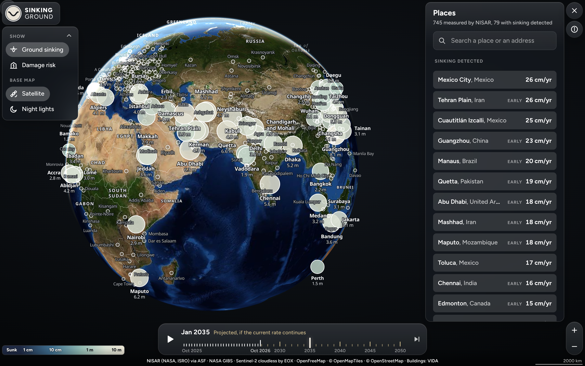

# Sinking Ground

A global map of ground that is sinking, measured from orbit by the NASA and ISRO
radar satellite NISAR, with a time bar that lets you go back through what has
been measured and forward into what happens if it continues.

For each place it shows where the ground is going down and how fast, which
built up areas sit on ground sinking unevenly enough to damage buildings, and
how sure the data is.

**Live:** https://sinking-ground.pages.dev

**Video:** https://youtu.be/pespec9YN6g

## What you see

## Your address

Type an address or coordinates in the search field. If a place covers it, the
reading opens at once. If not, the NISAR passes over a 56 km box around it are
downloaded from NASA and run through the same pipeline.

## Take action

1. **Get the proof.** A one page report for their spot, as a PDF or a link.
2. **Send it.** A ready written letter asking for an inspection or for
   answers about groundwater pumping, naming the office responsible.
3. **Find the others.** Join the city's WhatsApp group, or create your own
   and add it. Telegram, Element, Signal and other apps are supported too, in
   case a messaging platform is blocked in your country.

## How to read the map

Damage comes from uneven sinking, measured as **angular distortion**: the
difference in sinking between neighbouring ground divided by the distance
between them.

| Class | Rule | Colour |
| --- | --- | --- |
| No sinking detected | below the detection threshold | grey |
| Sinking evenly | sinking detected, distortion below 1/500 | blue |
| Cracking possible | distortion past 1/500 | amber |
| Cracking likely | distortion past 1/300 | red |
| Structural damage likely | distortion past 1/150 | pink |

The limits come from foundation engineering (Skempton and MacDonald 1956,
Bjerrum 1963). They are screening levels for neighbourhoods, not a verdict on
any single building.

**Sinking from before NISAR.** NISAR has watched these places since late 2025,
most of them only since June 2026, but the ground it sees sinking was sinking
long before. So by default the map assumes the sinking measured now has gone
on at the same rate since 2000. It is an estimate, not a measurement, and the
app says so wherever it is used. The control **Sinking before NISAR** in the
place panel changes it to since 2015 or not counted.

## What the data shows so far

Built on 2026-11-15 from 745 places. At least 1 km² of built up land is
detected sinking in 79 of them. The eight fastest:

| Place | Fastest zone | Area sinking | Record |
| --- | --- | --- | --- |
| Mexico City, Mexico | 26 cm per year | 402 km² | 11 months |
| Tehran Plain, Iran | 26 cm per year | 122 km² | 4 months (early) |
| Cuautitlán Izcalli, Mexico | 25 cm per year | 160 km² | 11 months |
| Guangzhou, China | 23 cm per year | 5 km² | 4 months (early) |
| Manaus, Brazil | 20 cm per year | 8 km² | 4 months (early) |
| Quetta, Pakistan | 19 cm per year | 56 km² | 4 months (early) |
| Abu Dhabi, United Arab Emirates | 18 cm per year | 21 km² | 4 months (early) |
| Mashhad, Iran | 18 cm per year | 154 km² | 4 months (early) |

"Early" means about four months of radar passes, a single season, so the
yearly figure may change as the record grows. Every place is in the app and in
`web/data/index.json`.

Most of the sinking found so far is in Iran and Mexico, mostly because of the
length of the record. Four months of passes only reveal sinking faster than
about 3 to 5 cm per year, and 668 of the 745 places have no more than that.
By about June 2027 every place will have a full year and a bar near 2 cm per
year.

## How the data is made

The `pipeline` folder turns raw NISAR products into the small files the map
loads. For each place in `pipeline/places.json`:

1. **Search** NASA's catalogue for NISAR L2 GUNW products (geocoded unwrapped
   interferograms) and pick the track, or merge two, that covers the place.
2. **Read only what is needed**: about 25 MB of each 2 GB product.
3. **Keep ground that can be trusted**: built up and bare ground (ESA
   WorldCover) whose radar echo stays stable.
4. **Clean each interferogram** of orbit errors and atmosphere.
5. **Build the time series** with a small baseline style network inversion.
6. **Combine ascending and descending tracks** where both cover the place,
   leaving out tracks that are too noisy.
7. **Detect sinking**: a rate beyond three times the map noise and beyond
   1 cm divided by the record length, sustained through the record.
8. **Measure uneven sinking** as the slope of the rate map over about 240 m.
9. **Export** a grid per place at 80 m.

Mexico City comes out at 26 cm per year over its fastest zone, in line with
the map NASA and JPL published in 2026, and its two viewing directions agree
to within about 1.5 cm per year.

## What this cannot tell you

* **It is a screening map.** One radar pixel is 80 m wide. It describes
  neighbourhoods, not a single building's foundations.
* **Sinking from before NISAR is assumed, not measured.**
* **Short records only see fast sinking.** "No sinking detected" means
  "nothing that fast", not "stable".
* **A summer record can mistake shrinking clay for sinking.** The places
  where this is likely are held back in `places.json`.
* **The projection is a straight line.** Real rates change with pumping,
  rainfall and regulation.
* **Farmland, grass, forest and wetland are blank** by design, since their
  changing moisture reads as sinking.
* **Motion is read as vertical**, and the NISAR products used are provisional
  releases.

## Credits

* Ground motion: NISAR L2 GUNW, NASA and ISRO, distributed by the Alaska
  Satellite Facility DAAC.
* Elevation: Copernicus DEM GLO 90, ESA. Land cover: ESA WorldCover 2021.
* Imagery on the globe: NASA GIBS, Blue Marble and VIIRS Black Marble.
* Close up imagery: Sentinel-2 cloudless by EOX IT Services GmbH
  (https://cloudless.eox.at, contains modified Copernicus Sentinel data 2024),
  CC BY-NC-SA 4.0.
* Buildings: Google Open Buildings, Microsoft Building Footprints and
  OpenStreetMap, merged by VIDA (source.coop).
* Borders, roads and names: OpenFreeMap, OpenMapTiles, OpenStreetMap
  contributors. Address search: OpenStreetMap Nominatim.
* Map library: MapLibre GL JS. Tile archive reader: PMTiles. Typeface: Figtree
  (SIL Open Font License).
