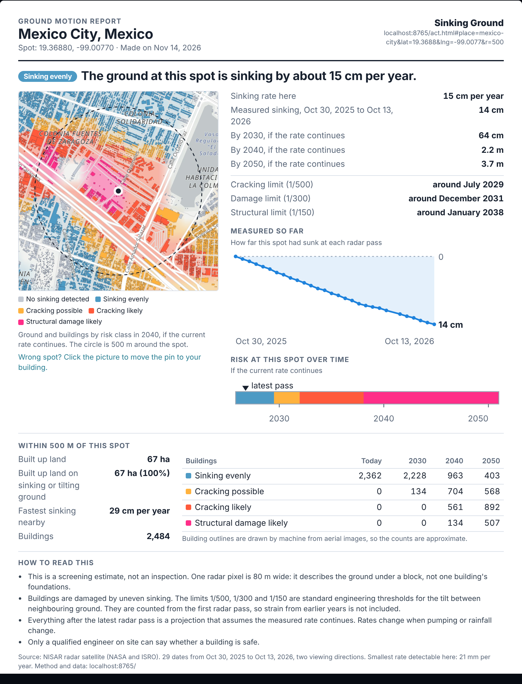

# Sinking Ground

A global map of ground that is sinking, measured from orbit by the NASA and ISRO
radar satellite NISAR, with a time bar that lets you go back through what has
been measured and forward into what happens if it continues.

It answers three questions for each place:

1. **Where is the ground going down, and how fast?**
2. **Which built up areas and buildings sit on ground that is sinking unevenly**
   enough to crack or damage them, and when do they pass the limits?
3. **How sure are we?** Every place states the smallest rate the data can
   detect so far, and short records are marked as early results.


## Run it

The app is live at https://sinking-ground.pages.dev.

It is a static site with no build step. To run it locally:

```bash
python3 -m http.server 8000 --directory web
```

Then open http://localhost:8000.

Three colour themes (Bone & ink, Slate & sage, Monochrome) can be picked under
Theme in the Show panel; the choice is remembered and also applies to the
report and letter pages.

Pick a place on the globe or in the list (the search button, top right), drag
the time bar, and zoom in to street level to see individual buildings. Click
anywhere inside a place to read the rate, how far that spot has sunk, and when
it passes the damage limits. The pane at the top left switches between ground
sinking and damage risk, and between satellite imagery and a dark map with city
lights.

A view can be shared by its address, for example
`#place=mexico-city&t=2040-01-01`. Add `&base=night` for the dark map, and
`&earlier=2015` or `&earlier=none` to change how sinking from before NISAR is
counted (see below).

Every push to `main` is published by the Cloudflare Pages project
`sinking-ground`, which is connected to this repository. Other branches are not
published. Before publishing it runs `node scripts/check-site.mjs`, and a
failed check stops the publish. `.github/workflows/check.yml` runs the same
check on pull requests, together with `python3 web/action/check.py`. To host it
somewhere else, publish the `web` folder on any static host (GitHub Pages,
Netlify, an S3 bucket).

The imagery, map tiles, building outlines and night lights are loaded from
public servers, so the visitor needs an internet connection. The close up
imagery (Sentinel-2 cloudless by EOX) is licensed for non commercial use; swap
the tile address in `web/js/basemap.js` if you need something else.

## What you see

| Thing on screen | Meaning |
| --- | --- |
| Bubbles on the globe | One per place. Size and colour show how far the fastest zone has sunk at the date on the time bar. A small faint dot means nothing detected yet. |
| Time bar, white ticks | Measured by NISAR. One tick per radar pass, 12 days apart. |
| Time bar, orange ticks | Projection to 2050, one tick per year, that assumes the measured rate simply continues. A scenario, not a forecast. |
| Blue layer | How far the ground has sunk since the first radar pass (log scale, 1 cm to 10 m). |
| Damage risk layer | The same ground coloured by risk class instead. |
| Buildings | Coloured by the risk class of the ground under them at the chosen date. |
| Built up land past damage limits | Area in each damage class at the chosen date, and when each limit is first passed. An estimate: it counts sinking from before NISAR (see below). |

### Why buildings change colour

A building that sinks evenly with its whole neighbourhood is usually fine
structurally (flooding and drainage are another matter). Damage comes from
uneven sinking. We measure that as **angular distortion**: the difference in
sinking between neighbouring ground divided by the distance between them. It
grows every year the ground keeps sinking unevenly.

| Class | Rule | Colour |
| --- | --- | --- |
| No sinking detected | below the detection threshold | grey |
| Sinking evenly | sinking detected, distortion below 1/500 | blue |
| Cracking possible | distortion past 1/500 | amber |
| Cracking likely | distortion past 1/300 | red |
| Structural damage likely | distortion past 1/150 | pink |

The limits are the classic ones from foundation engineering (Skempton and
MacDonald 1956, Bjerrum 1963). They are screening levels for neighbourhoods,
not a verdict on any single building.

### Sinking from before NISAR

NISAR has watched these places since late 2025. Where sinking is detected, the
fastest tilting ground gains about 1/1250 per year, so counted from the first
radar pass no ground reaches even the first limit (1/500) for two and a half
years. On that count the damage classes are empty through everything measured
so far. But the ground NISAR sees sinking was sinking long before it launched.

So the damage classes also count earlier strain, and the assumption for it
comes from the NISAR data itself: **the uneven sinking measured now is taken to
have been going on at the same rate since 2000.** It is the assumption the
projection makes (the measured rate continues to 2050) applied backwards over
the same length of time. It is an estimate, not a measurement, and the app says
so wherever it is used.

* The place panel has a control, **Sinking before NISAR**: assumed since 2000
  (the default), assumed since 2015, or not counted. "Not counted" shows only
  the strain built up since the first radar pass, and then says when each limit
  is first passed.
* Only the damage classes use it. How far the ground has sunk (the blue layer,
  the big number, the chart) is always counted from the first radar pass.
* A rate carried back 25 years carries its noise back too. Uneven sinking is
  therefore kept only where it stands clear of chance (step 8 below).
* It is only assumed in places where sinking is detected over at least 1 km².
  The small spots in other places can be earthworks or landfill, which have
  not been sinking like that for decades.

Built up land past the damage limits at the latest radar pass, with sinking
assumed since 2000:

| Place | Cracking possible | Cracking likely | Structural damage likely |
| --- | --- | --- | --- |
| Mexico City, Mexico | 52.2 km² | 35.8 km² | 7.5 km² |
| Mashhad, Iran | 2.1 km² | 7.5 km² | 0.2 km² |
| Tehran Plain, Iran | 2.0 km² | 5.2 km² | 0.6 km² |
| Toluca, Mexico | 1.3 km² | 1.1 km² | 1.5 km² |
| Quetta, Pakistan | 0.0 km² | 2.0 km² | 0.6 km² |
| Delhi, India | 1.2 km² | 1.2 km² | 0.0 km² |
| Bandung, Indonesia | 0.0 km² | 0.9 km² | 0.0 km² |
| Celaya, Mexico | 0.5 km² | 0.0 km² | 0.0 km² |
| Rafsanjan Plain, Iran | 0.2 km² | 0.0 km² | 0.0 km² |
| Istanbul, Türkiye | 0.0 km² | 0.1 km² | 0.0 km² |

Each area is counted once, in its worst class. With "not counted" every figure
above is zero. In Abidjan, Ahmedabad, Corcoran, Isfahan and Shanghai the uneven
sinking does not stand clear of chance yet, so they show no damage classes
under any setting.

## What the data shows so far

Built on 2026-11-15 from 82 places. Sinking is detected over at least
1 km² in 16 of them:

| Place | Fastest zone | Area sinking | Record | Smallest detectable rate |
| --- | --- | --- | --- | --- |
| Mexico City, Mexico | 26 cm per year | 383 km² | 11 months | 2.1 cm per year |
| Tehran Plain, Iran | 23 cm per year | 56 km² | 4 months (early) | 6.1 cm per year |
| Quetta, Pakistan | 18 cm per year | 49 km² | 4 months (early) | 6.1 cm per year |
| Mashhad, Iran | 18 cm per year | 108 km² | 4 months (early) | 6.1 cm per year |
| Toluca, Mexico | 16 cm per year | 9 km² | 11 months | 2.8 cm per year |
| Rafsanjan Plain, Iran | 16 cm per year | 22 km² | 4 months (early) | 6.1 cm per year |
| Central Valley (Corcoran), United States | 14 cm per year | 3 km² | 11 months | 5.9 cm per year |
| Abidjan, Côte d'Ivoire | 13 cm per year | 4 km² | 4 months (early) | 9.7 cm per year |
| Istanbul, Türkiye | 11 cm per year | 6 km² | 4 months (early) | 7.1 cm per year |
| Bandung, Indonesia | 11 cm per year | 16 km² | 4 months (early) | 6.1 cm per year |
| Delhi, India | 10 cm per year | 3 km² | 11 months | 2.3 cm per year |
| Shanghai, China | 8 cm per year | 2 km² | 4 months (early) | 6.8 cm per year |
| Celaya, Mexico | 8 cm per year | 5 km² | 11 months | 2.4 cm per year |
| Isfahan, Iran | 8 cm per year | 1 km² | 4 months (early) | 6.1 cm per year |
| Ahmedabad, India | 4 cm per year | 5 km² | 11 months | 2.2 cm per year |
| Los Angeles, United States | 3 cm per year | 1 km² | 11 months | 2.2 cm per year |

"Early" means only about four months of radar passes. Those rates were
measured over a single season, so the yearly figure may change as the record
grows.

No sinking above the detection limit (yet) in the other 66 places, among
them Jakarta, Houston, New Orleans, New York and Venice, all known to sink more
slowly than a few months of data can reveal. Five places in `places.json`
(Willcox Basin, Larissa, Konya Basin, Kathmandu, Yangon) are skipped for now
because too little built up ground gave a stable radar signal, and one
(Jeddah) because its only radar track is still too noisy (map noise above
6 cm per year) to say anything.

How far to trust the table: 12 of the 16 places are seen from two directions
that read similar rates inside the sinking area (see Independent checks).
Celaya, Istanbul, Shanghai and Tehran Plain are seen from one direction only
and are not cross checked. In Los Angeles the two directions disagree (1 and
3 cm per year), so treat that row as weak.


## How the data is made

The `pipeline` folder turns raw NISAR products into the small files the map
loads. For each place in `pipeline/places.json` it does this:

1. **Search** NASA's catalogue (CMR) for NISAR Level 2 GUNW products
   (geocoded unwrapped interferograms) over the place. `search.py`
2. **Read only what is needed.** Each product is a 2 GB HDF5 file. We open it
   remotely, ask HDF5 where the chunks covering the place live, and download
   just those byte ranges: about 25 MB and 8 seconds per file. `fetch.py`
3. **Keep ground that can be trusted.** Radar phase over wetlands follows the
   water level, and over forest, grass and farmland it follows the moisture in
   plants and soil. So only built up and bare ground (ESA WorldCover) is
   analysed, and only pixels whose radar echo stays stable (coherence of 0.5
   or more). `landcover.py`
4. **Clean each interferogram.** Remove a plane and a term proportional to
   elevation (orbit errors and layered atmosphere), then remove the smooth
   atmosphere estimated from ground that is not moving. `process.py`
5. **Build the time series.** A small baseline style network inversion gives
   the ground position at every radar pass. Whatever is fast in time but
   smooth in space is treated as weather and removed.
6. **Combine two viewing directions** (ascending and descending tracks) when
   both cover the place. Motion is read as vertical.
7. **Detect sinking.** A pixel counts as sinking when its rate is beyond
   three times the map noise and beyond a seasonal allowance of 2 cm divided
   by the record length, on gentle terrain, in patches of at least a quarter
   of a square kilometre. Short records therefore have to clear a higher bar.
   The sinking also has to be sustained: each third of the record must show
   at least 30 percent of its share, which removes one off episodes such as
   a frozen winter.
8. **Measure uneven sinking** as the slope of the rate map (angular distortion
   per year), kept only where it is clearly above the noise: steeper than 99
   percent of the ground that is not sinking, and in a patch larger than that
   ground would show even once by chance. The map multiplies this rate by
   decades, so a handful of noisy pixels must not get through.
9. **Export** a Web Mercator grid per place at 80 m: rate, distortion rate,
   flags, and the measured wiggle around the straight line at every pass.
   `export.py`

Checks made while building it:

* Mexico City comes out at 26 cm per year averaged over its fastest zone
  (29 at the peak) across a full year of passes, in line with the map NASA
  and JPL published in 2026 and with earlier studies.
* The two independent viewing directions over Mexico City agree to within
  about 1.5 cm per year, pixel by pixel.
* Places the literature reports as fast sinking come out fast here too
  (Tehran, Mashhad, Rafsanjan, Quetta, Delhi, Celaya, Bandung), and places
  known to sink slowly come out as not detected.
* Before the land cover and seasonal rules were added, forest around
  São Paulo, marsh around New Orleans and rice fields around Semarang all
  showed up as fast "sinking" while the built up land beside them read zero.
  They no longer do. That is why those rules exist.
* New York appeared to sink 6 cm in its first winter and then not at all.
  The sustained sinking rule removes that kind of episode.

### Independent checks

Recognising a famous sinking city on the map proves little. Two checks that do
not depend on anyone's expectations are computed for every place and shown in
its panel under "How this was checked":

* **Two viewing directions.** Where NISAR sees a place on both an ascending and
  a descending track, the two are processed separately (different orbits, days
  and atmosphere) and their rate maps compared. `agreement` in
  `web/data/index.json` holds the typical difference, and inside detected
  sinking the rate each direction reads. Places seen from one direction only
  are marked as not cross checked.
* **GNSS ground stations.** `python -m pipeline.gnss` compares the map with the
  long term vertical rate of every permanent GNSS station that stands on mapped
  ground (MIDAS velocities, Nevada Geodetic Laboratory, open data). A station
  averages over many years and the map over months, so the two differ where
  sinking has changed speed: read it as a sanity check, not a calibration.

Radar motion is relative. Zero is the typical ground inside a place's box that
is not moving, so rates are "relative to the surroundings", not to sea level.
Only the box is measured: `reaches_edge` flags detected sinking that runs into
the rim of the box and probably continues outside it.

Results on 2026-11-15:

* 59 of the 82 places are seen from two directions. Their rate maps differ by
  12.7 mm per year in the median place. That is the honest pixel level
  uncertainty of a few months of data, and it is why only sinking well above
  it is reported.
* 329 GNSS stations stand on mapped ground in 51 places. The map and the
  station differ by 5.8 mm per year in the median and by less than 23 mm per
  year for nine stations in ten. The fastest station, MMX1 in Mexico City,
  sinks 265 mm per year and the map reads 230 at that spot.
* The comparison also shows a weakness. Where a whole basin sinks gently and
  evenly (Bogotá: four stations at 28 to 46 mm per year, the map reads 3 to 8;
  parts of Houston; the station in Celaya), the map reads close to zero. The
  processing takes "typical ground in the box" as zero and removes whatever is
  smooth over several kilometres as atmosphere, so sinking that is broad and
  even is partly removed with it. The map finds sinking that stands out from
  its surroundings, not a slow drop of the whole box.

### Where the data lives

| Folder | What | Size |
| --- | --- | --- |
| `web/data` | what the map loads: one small index and two files per place | 19 MB |
| `data/nisar` | the radar windows the map data is built from, plus elevation and land cover on the same grids, and a manifest of the NASA products they came from | 1.2 GB |

Both are in the repository. `data/nisar` is the downloaded radar data in a
compact form (see `data/nisar/README.md`), so nothing has to be fetched again
to rebuild or retune the map data.

### Rebuild from the repository (no download, no login)

```bash
python3 -m venv .venv
.venv/bin/pip install -r pipeline/requirements.txt
```

```bash
.venv/bin/python -m pipeline.run --all --offline
```

### Update or add places

Fetching new radar passes needs a free Earthdata Login
(https://urs.earthdata.nasa.gov). Either generate a token there and export it
as below, or keep your login in `~/.netrc`
(`machine urs.earthdata.nasa.gov login <user> password <password>`, file mode
600). Never commit either.

```bash
export EARTHDATA_TOKEN=paste_your_token_here
```

```bash
.venv/bin/python -m pipeline.run --place mexico-city
```

```bash
.venv/bin/python -m pipeline.run --all
```

To add a place, add an entry to `pipeline/places.json` (centre and box size in
km) and run it. A one off box also works:

```bash
.venv/bin/python -m pipeline.run --lat 19.4 --lon -99.05 --size 64 --id my-place --name "My Place"
```

New windows are added to `data/nisar`, so reruns only fetch radar passes that
are not there yet. Commit the new files along with the updated `web/data`. As
NISAR keeps flying, rerunning lengthens every record, lowers every detection
threshold, and turns early results into firm ones.

## What this cannot tell you

* **It is a screening map.** One radar pixel is 80 m wide. It describes
  neighbourhoods, not a single building's foundations.
* **Strain from before NISAR is assumed, not measured.** The damage classes
  take today's uneven sinking to have gone on at the same rate since 2000.
  Where sinking began later or used to be slower (new fill, reclaimed land)
  they overstate. Where it used to be faster they understate. Set "Sinking
  before NISAR" to "not counted" to see only what has built up since the first
  radar pass.
* **Short records only see fast sinking.** Most places have about four months
  of passes so far, which only reveals sinking faster than roughly 6 cm per
  year. "No sinking detected" there means "nothing that fast", not "stable".
* **The projection is a straight line.** Real rates change with pumping,
  rainfall and regulation.
* **Farmland, grass, forest and wetland are blank** by design, including
  places where the ground under them truly is sinking.
* **The damage limits are borrowed from a finer scale.** In foundation
  engineering, angular distortion is measured between neighbouring columns of
  one building, a few metres apart, with the tilt of the whole building taken
  out. The map measures the slope of the sinking rate between 80 m pixels. That
  smooths away sharp local differences and includes whole building tilt, so it
  is a related quantity, not the same one.
* **Rates are relative and only the box is measured.** Zero is the typical
  ground in the box that is not moving. Sinking outside the box is not seen,
  and broad even sinking of most of the box is understated (the GNSS
  comparison above shows it for Bogotá).
* **Motion is read as vertical.** Sideways motion on slopes is not separated.
* **NISAR products used here are provisional** releases.
* **Building outlines are machine drawn** from aerial imagery. Some are missing
  or wrong, and heights are not known.

## Layout

```
.github/workflows/   check.yml: runs the checks on pull requests
scripts/
  check-site.mjs     checks the site before it is published
data/nisar/          the radar windows, elevation, land cover and manifest
pipeline/            Python: NISAR products to map data
  places.json        the places to process
  run.py             command line entry point
  search.py          find products in NASA's catalogue
  fetch.py           remote partial reads of the HDF5 products, storage format
  process.py         interferograms to ground motion, detection, distortion
  dem.py             Copernicus elevation
  landcover.py       ESA WorldCover
  export.py          grids and files for the web app
  quicklook.py       small PNG previews for checking results by eye
  gnss.py            compare the map with GNSS ground stations
web/                 the static site
  index.html
  css/style.css
  act.html           take action: report, letter, find the others
  action/            city files, translations and policy examples for that page
  js/act.js          the take action page
  js/pdf.js          PDF downloads made in the browser
  js/app.js          map layers, panes, controls
  js/basemap.js      the map style: imagery or night lights, borders, names
  js/data.js         reading the per place grids
  js/timeline.js     the time bar
  js/config.js       colours, limits, formatting
  data/              output of the pipeline (index.json and two files per place)
  vendor/            MapLibre GL JS, PMTiles, html2canvas and the Figtree typeface
```

## Take action

Seeing the problem is step zero. `web/act.html` turns a spot on the map into
something a person can use. It opens from the place panel or from the popup
after clicking a building.

| Step | What the person gets |
| --- | --- |
| 1. Get the proof | A one page report for their spot: the measured sinking, when the ground passes each damage limit, a picture of the buildings around them by risk class, counts of buildings within 250 or 500 m, and the honest limits of the data. It downloads as a one page PDF (or prints on one A4 page) and has a link to share. |
| 2. Send it | A ready written letter, filled in with those numbers, asking for an inspection or for answers about groundwater pumping. It names the office responsible and the law that obliges a reply. Copy, email, print, or download as PDF or text. |
| 3. Find the others | A link to the city's group, ways to pass the report on, a short guide to turning a few neighbours into a group, and four cities that stopped their sinking with what they did. |

Nothing the person types (name, address) leaves their device.

The report and the letter use the same damage classes as the map, so they also
count sinking from before NISAR (see above). The page takes the map's setting
from the link (`&earlier=2015`, `&earlier=none`), and both the report and the
letter say that this part is an estimate, not a measurement.

The PDFs are made in the browser, with no server: the page is drawn to an
image and wrapped in a PDF file (`web/js/pdf.js`). That keeps every script
looking exactly as the browser draws it, at the cost that the text in the PDF
is a picture and cannot be selected or searched. The address of the live
report stays clickable.



### Cities with a full local guide

For the ten places where the most built up land is projected to pass the
cracking limit, each has its own file naming the offices responsible, how to
reach them, the law that obliges a reply and its deadline, and the emergency
number. Every other place gets the report, a general letter and general
guidance on who is usually responsible.

| City | Page and letter language | Telegram reachable there |
| --- | --- | --- |
| Mexico City, Mexico | Spanish | yes (neighbours mostly use WhatsApp) |
| Toluca, Mexico | Spanish | yes (neighbours mostly use WhatsApp) |
| Tehran, Iran | Persian | no, blocked |
| Mashhad, Iran | Persian | no, blocked |
| Quetta, Pakistan | Urdu, English | no, blocked |
| Delhi, India | English, Hindi | yes |
| Bandung, Indonesia | Indonesian | yes (neighbours mostly use WhatsApp) |
| Istanbul, Türkiye | Turkish | yes |
| Abidjan, Côte d'Ivoire | French | yes (neighbours mostly use WhatsApp) |
| Shanghai, China | Chinese | no, blocked |

Each city is one file, `web/action/cities/<place id>.json`, described in
`web/action/README.md`. Each contact carries the official page it comes from
and the date it was gathered.

**Before promoting the page in a city, have someone who lives there check its
file and its translation.** The contacts were gathered by research from a
desk in November 2026. Many government sites refused connections from the
research environment, so a good share of the phone numbers and addresses were
read from search results of the official site, not from the live page. The
translations were written by a language model and have not been read by
native speakers. Fixing or adding a city is a change to one JSON file, with
no code. `python3 web/action/check.py` checks every city file and translation.

### Groups

The idea is one group per city where neighbours organise. When a group exists,
add it to that city's file and the page shows a join button:

```json
"groups": [{ "platform": "telegram", "url": "https://t.me/your_group", "label": "Sinking Ground Mexico City" }]
```

Until then the page says there is no group yet and invites the reader to start
one. `platform` is free text, so a WhatsApp or WeChat group works the same
way. That matters: Telegram is blocked in four of the ten cities (see the
table), and where it does work most neighbourhood groups run on WhatsApp.
Each city file's `organising` note says what applies there and what to be
careful about, and the page hides the Telegram share button where Telegram
does not open.

### Languages

The page and the letters exist in English, Spanish, French, Turkish,
Indonesian, Persian, Urdu, Hindi and Chinese. Every sentence lives in
`web/action/i18n/<language>.json`; `en.json` is the source. A language listed
in `web/action/i18n/index.json` appears in the language menu. The page opens in
the city's own language and writes the letter in it, with numbers and dates in
the local format (the Persian page uses the Solar Hijri calendar). The
examples of cities that stopped their sinking are in `web/action/cases.json`,
each with its sources, with translations in `web/action/i18n/cases.<language>.json`.
The map itself is in English only.

### For other features

The map announces what a person is looking at, so further features can plug in
without touching the map code:

```js
document.addEventListener('sinkingground:place', e => { /* e.detail: id, name, country, detected */ });
document.addEventListener('sinkingground:inspect', e => { /* e.detail: place, lng, lat, riskClass, rate_mm_per_year, sunk_mm, time, projected, earlierSince */ });
document.addEventListener('sinkingground:time', e => { /* e.detail: time, projected */ });
```

## Next steps

* Have local people check each city file and translation.
* Create the city groups and add their links, on a platform that opens in
  each country.
* Translate the map itself.
* Collect crack reports from residents on the map (this needs a server and
  moderation, so it is not built).
* Rerun the pipeline as radar passes accumulate, add places, mosaic
  neighbouring radar frames for places that straddle two, and use the weather
  model layers shipped inside the products for a better atmosphere correction.

## Sources

Everything the project uses, where it comes from, and what it was used for.

### Measurement data

| Source | Used for |
| --- | --- |
| **NISAR L2 GUNW** (geocoded unwrapped interferograms, provisional and validated releases), NASA and ISRO, distributed by the Alaska Satellite Facility DAAC, https://nisar.asf.earthdatacloud.nasa.gov | The ground motion itself: unwrapped phase, coherence, connected components, ionosphere screen, incidence angle. Every rate, area and date on the map comes from these files. The products used are listed one by one in `data/nisar/manifest.json`. |
| **NASA Common Metadata Repository (CMR)**, https://cmr.earthdata.nasa.gov | Finding which NISAR products cover a place (`pipeline/search.py`). |
| **Copernicus DEM GLO 90**, ESA, https://copernicus-dem-90m.s3.amazonaws.com | Elevation: the term that removes layered atmosphere, and the terrain slope limit in detection (`pipeline/dem.py`). |
| **ESA WorldCover 2021** (v200, CC BY 4.0), https://esa-worldcover.s3.eu-central-1.amazonaws.com | Land cover: only built up and bare ground is analysed, water and wetland are masked, built up area is counted (`pipeline/landcover.py`). |
| **MIDAS GNSS station velocities (IGS14)**, Nevada Geodetic Laboratory, https://geodesy.unr.edu/velocities/midas.IGS14.txt. Method: Blewitt, Kreemer, Hammond and Gazeaux (2016), "MIDAS robust trend estimator for accurate GPS station velocities without step detection", J. Geophys. Res. Solid Earth, doi:10.1002/2015JB012552 | Independent check of the map against ground stations (`pipeline/gnss.py`). Not used to make or adjust the map. |

### Map display

| Source | Used for |
| --- | --- |
| **NASA GIBS**: Blue Marble Shaded Relief and Bathymetry, VIIRS Black Marble, https://gibs.earthdata.nasa.gov | Imagery on the globe (day and night base maps). |
| **Sentinel-2 cloudless 2024** by EOX IT Services GmbH, https://cloudless.eox.at (contains modified Copernicus Sentinel data 2024), CC BY-NC-SA 4.0 | Close up satellite imagery. |
| **OpenFreeMap**, **OpenMapTiles**, **OpenStreetMap contributors**, https://openfreemap.org, https://www.openmaptiles.org, https://www.openstreetmap.org/copyright | Borders, roads, place names, map fonts, and the light base map of the report page. |
| **Google Open Buildings, Microsoft Building Footprints and OpenStreetMap**, merged by VIDA, https://data.source.coop/vida/google-microsoft-osm-open-buildings | Building outlines that are coloured by risk class and counted in the report. |

### Methods and reference values

| Source | Used for |
| --- | --- |
| Skempton and MacDonald (1956), "The allowable settlements of buildings", Proc. Institution of Civil Engineers; Bjerrum (1963), "Allowable settlements of structures", Proc. European Conf. on Soil Mechanics and Foundation Engineering | The damage limits 1/500, 1/300 and 1/150 on angular distortion. The values were checked against a textbook summary (https://eng.libretexts.org/Bookshelves/Civil_Engineering/Fundamentals_of_Foundation_Engineering_and_their_Applications_2e/04%3A_SETTLEMENT_OF_SHALLOW_FOUNDATIONS/4.03%3A_Tolerable_settlement), not against the original papers. |
| NISAR Data User Guide, Alaska Satellite Facility, https://nisar-docs.asf.alaska.edu (pages on data access, GUNW products, direct S3 access and GDAL) | How to find, authenticate for and read the products; the layout and units of the GUNW files. |
| Published NASA and JPL map of Mexico City and earlier studies (as stated under "Checks made while building it") | Plausibility check of the Mexico City rate by the original authors of the pipeline. No citation was recorded in the repository. |

### Text about places

| Source | Used for |
| --- | --- |
| `pipeline/places.json`, field `driver` | The "main cause reported" line in a place's panel. For most places this text was written from general knowledge and **has no recorded source**. Treat it as a hint, not a finding. |
| DGGV, "Analysis of surface displacements caused by mine flooding for the project FloodRisk", https://www.dggv.de/e-publikationen/analysis-of-surface-displacements-caused-by-mine-flooding-for-the-project-floodrisk-with-sar-interferometry/ | Driver text for the Ruhr area (last mines closed in 2018, mine water rising). |
| Enerdata, "Netherlands stops production at Groningen gas field", https://www.enerdata.net/publications/daily-energy-news/netherlands-stops-production-groningen-gas-field.html | Driver text for Groningen (production ended on 1 October 2023). |
| Geological Quarterly (Polish Geological Institute), subsidence map of the Upper Silesian Coal Basin, https://gq.pgi.gov.pl/article/view/33866 | Driver text for Katowice (active coal mining). |
| Chaussard, Wdowinski, Cabral-Cano and Amelung (2014), "Land subsidence in central Mexico detected by ALOS InSAR time-series", Remote Sensing of Environment 140, https://faculty.fiu.edu/~swdowins/publications/Chaussard-et-al-RSE-2014.pdf | Driver text for Guadalajara (groundwater pumping). Read through a summary, not the full paper. |
| `web/action/cities/*.json` (each entry carries its own `source` link and a `checked` date) | Offices, contact details, laws and deadlines named in the letters. |
| `web/action/cases.json` (each case carries its `sources`) | The examples of what residents achieved elsewhere. |

The reply deadlines in the city files were checked a second time on
2026-11-15 against these pages. All eight agree. Two notes: for Iran the law
says 10 days without saying working or calendar days, and for Côte d'Ivoire one
news report quotes 15 days where the others say 30.

| Law | Checked against |
| --- | --- |
| India, Right to Information Act 2005 (30 days) | https://humanrightsinitiative.org/programs/ai/rti/india/officials_guide/time_limits.htm |
| Mexico, Ley General de Transparencia y Acceso a la Información Pública (20 days) | https://mley.mx/LGTAIP/ |
| Indonesia, Law 14 of 2008 (10 working days) | https://jdih.kemenkeu.go.id/api/download/FullText/2008/14TAHUN2008UU.htm |
| Türkiye, Law 4982 (15 working days) | https://www.freedominfo.org/regions/europe/turkey |
| Pakistan, Balochistan Right to Information Act 2021 (15 working days) | https://cpdi-pakistan.org/process-and-specimen-of-filing-information-request-and-complaint-under-rti-laws |
| Iran, Law on Publication of and Free Access to Information (10 days) | https://www.rti-rating.org/wp-content/uploads/2018/09/Iran.FOI-law-and-regulations.English.pdf |
| Côte d'Ivoire, Law 2013-867 (30 days) | https://www.fratmat.info/article/2375060/culture/anne-marie-konan-payne-presidente-de-la-caidp-le-journalisme-dinvestigation-est-un-maillon-important-dans-la-societe |
| China, Regulations on Open Government Information 2019 (20 working days) | https://www.chinalawtranslate.com/open-government-information-regulations-of-the-p-r-c-2019/ |

### Software

| Source | Used for |
| --- | --- |
| MapLibre GL JS, PMTiles, html2canvas (licences in `web/vendor`) | Drawing the map, reading the building archive, drawing the PDF report and letter. |
| Figtree typeface (SIL Open Font License, `web/vendor`) | Text in the app. |
| numpy, scipy, h5py, pyproj, rasterio, requests, fsspec, aiohttp (`pipeline/requirements.txt`) | The processing pipeline. |

### Not from a dataset

The colour themes, the wording of the app, the 2050 projection (the measured
rate simply continued) and the assumption that uneven sinking began in 2000
are choices made by the authors, not data. The list of places was chosen from
general knowledge of where sinking is reported; whether a place shows sinking
on the map comes only from the NISAR data.
