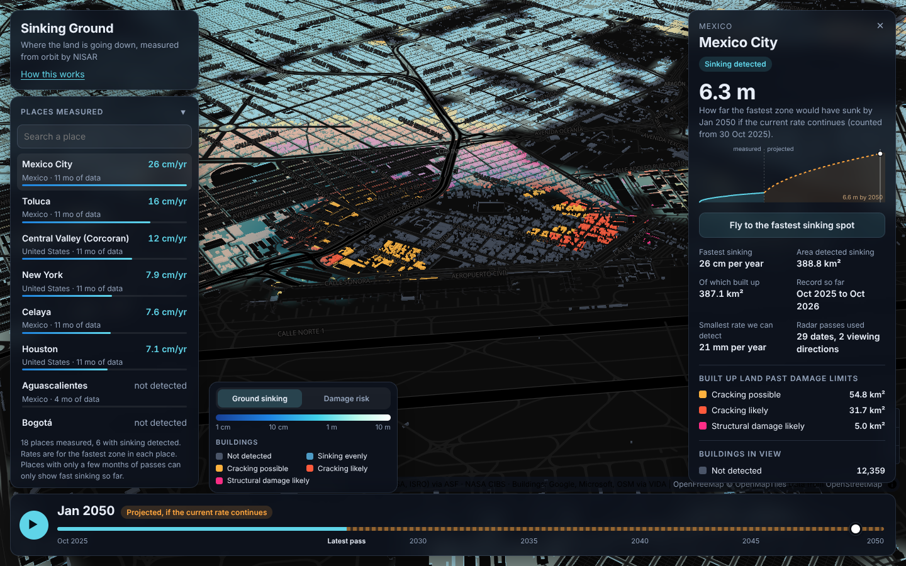

# Sinking Ground

A global map of ground that is sinking, measured from orbit by the NASA and ISRO
radar satellite NISAR, with a time bar that lets you go back through what has
been measured and forward into what happens if it continues.

It answers three questions for each place:

1. **Where is the ground going down, and how fast?**
2. **Which built up areas and buildings sit on ground that is sinking unevenly**
   enough to crack or damage them, and when do they pass the limits?
3. **How sure are we?** Every place states the smallest rate the data can
   detect so far, and short records are marked as early results.



## Run it

The app is live at https://sinking-ground.pages.dev.

It is a static site with no build step. To run it locally:

```bash
python3 -m http.server 8000 --directory web
```

Then open http://localhost:8000.

Pick a place on the globe or in the list (the search button, top right), drag
the time bar, and zoom in to street level to see individual buildings. Click
anywhere inside a place to read the rate, how far that spot has sunk, and when
it passes the damage limits. The pane at the top left switches between ground
sinking and damage risk, and between satellite imagery and a dark map with city
lights.

A view can be shared by its address, for example
`#place=mexico-city&t=2040-01-01`. Add `&base=night` for the dark map, and
`&earlier=2015` or `&earlier=none` to change how sinking from before NISAR is
counted (see below).

Every push to `main` is published by the Cloudflare Pages project
`sinking-ground`, which is connected to this repository. Other branches are not
published. Before publishing it runs `node scripts/check-site.mjs`, and a
failed check stops the publish. `.github/workflows/check.yml` runs the same
check on pull requests, together with `python3 web/action/check.py`. To host it
somewhere else, publish the `web` folder on any static host (GitHub Pages,
Netlify, an S3 bucket).

The imagery, map tiles, building outlines and night lights are loaded from
public servers, so the visitor needs an internet connection. The close up
imagery (Sentinel-2 cloudless by EOX) is licensed for non commercial use; swap
the tile address in `web/js/basemap.js` if you need something else.

## What you see

| Thing on screen | Meaning |
| --- | --- |
| Bubbles on the globe | One per place with sinking detected. Size and colour show how far the fastest zone has sunk at the date on the time bar. |
| Rings on the globe | Places NISAR measures where nothing sinks fast enough to detect yet. Hover one for the length of its record and the smallest rate it can detect. |
| Chart in the place panel | How far the fastest zone has sunk: measured (white), then projected (orange). Like the time bar, it gives the measured months more room than the years after them, and it does so on both axes, so a steady rate draws one straight line and the projection carries straight on from the measurements. With sinking before NISAR counted, its labels include that estimate and a note under it gives the amount the line starts from. |
| Time bar, white ticks | Measured by NISAR. One tick per radar pass, 12 days apart. |
| Time bar, orange ticks | Projection to 2050, one tick per year, that assumes the measured rate simply continues. A scenario, not a forecast. |
| Blue layer | How far the ground has sunk (log scale, 1 cm to 10 m). By default it counts the years before NISAR too, as an estimate (see below). |
| Damage risk layer | The same ground coloured by risk class instead. |
| Buildings | Coloured by the risk class of the ground under them at the chosen date. |
| Built up land past damage limits | Area in each damage class at the chosen date, and when each limit is first passed. An estimate: it counts sinking from before NISAR (see below). |

### Why buildings change colour

A building that sinks evenly with its whole neighbourhood is usually fine
structurally (flooding and drainage are another matter). Damage comes from
uneven sinking. We measure that as **angular distortion**: the difference in
sinking between neighbouring ground divided by the distance between them. It
grows every year the ground keeps sinking unevenly.

| Class | Rule | Colour |
| --- | --- | --- |
| No sinking detected | below the detection threshold | grey |
| Sinking evenly | sinking detected, distortion below 1/500 | blue |
| Cracking possible | distortion past 1/500 | amber |
| Cracking likely | distortion past 1/300 | red |
| Structural damage likely | distortion past 1/150 | pink |

The limits are the classic ones from foundation engineering (Skempton and
MacDonald 1956, Bjerrum 1963). They are screening levels for neighbourhoods,
not a verdict on any single building.

### Sinking from before NISAR

NISAR has watched these places since late 2025, most of them only since June
2026. Counted from the first radar pass alone, Tehran, sinking 26 cm per year,
has sunk 8.5 cm, and no ground reaches even the first damage limit (1/500) for
years. But the ground NISAR sees sinking was sinking long before it launched.

So the map also counts the years before NISAR, and the assumption for it comes
from the NISAR data itself: **the sinking and the uneven sinking measured now
are taken to have been going on at the same rate since 2000.** It is the
assumption the projection makes (the measured rate continues to 2050) applied
backwards over the same length of time. It is an estimate, not a measurement,
and the app says so wherever it is used.

* The place panel has a control, **Sinking before NISAR**: assumed since 2000
  (the default), assumed since 2015, or not counted. It applies to how far the
  ground has sunk (the bubbles, the blue layer, the big number, the click
  popup) and to the damage classes. "Not counted" shows only what NISAR
  measured since its first radar pass.
* The big number and the popup always say how much of the total NISAR
  measured, and the chart notes the estimated amount it starts from. With the
  default, Tehran reads 6.9 m since 2000, of which 8.5 cm measured.
* The take action report and letter keep to measured amounts, since they are
  evidence for an authority. Their damage limits use the same setting as the
  map and say so.
* A rate carried back 25 years carries its noise back too. Sinking is only
  counted where it clears the detection bar, and uneven sinking only where it
  stands clear of chance (steps 7 and 8 below).
* It is only assumed in places where at least 1 km² of built up land is
  detected sinking. The spots in other places can be earthworks, pits, mines
  or landfill, which have not been sinking like that for decades.

Built up land past the damage limits at the latest radar pass, with sinking
assumed since 2000:

| Place | Cracking possible | Cracking likely | Structural damage likely |
| --- | --- | --- | --- |
| Mexico City, Mexico | 51.6 km² | 24.8 km² | 1.4 km² |
| Tehran Plain, Iran | 22.1 km² | 8.6 km² | 0.5 km² |
| Mashhad, Iran | 17.0 km² | 1.8 km² | 0.0 km² |
| Cuautitlán Izcalli, Mexico | 13.4 km² | 3.0 km² | 0.2 km² |
| Quetta, Pakistan | 11.7 km² | 4.8 km² | 0.0 km² |
| Toluca, Mexico | 1.3 km² | 1.5 km² | 0.5 km² |
| Kabul, Afghanistan | 1.6 km² | 0.7 km² | 0.0 km² |
| Bandung, Indonesia | 2.3 km² | 0.0 km² | 0.0 km² |
| Manaus, Brazil | 2.2 km² | 0.1 km² | 0.0 km² |
| Puebla, Mexico | 2.2 km² | 0.0 km² | 0.0 km² |
| Neyshabur, Iran | 2.2 km² | 0.0 km² | 0.0 km² |
| Chennai, India | 1.2 km² | 0.9 km² | 0.0 km² |
| Abu Dhabi, United Arab Emirates | 1.4 km² | 0.1 km² | 0.0 km² |
| Maputo, Mozambique | 1.1 km² | 0.3 km² | 0.0 km² |
| Delhi, India | 1.2 km² | 0.1 km² | 0.0 km² |
| Guangzhou, China | 1.0 km² | 0.2 km² | 0.0 km² |
| Lomé, Togo | 1.0 km² | 0.0 km² | 0.0 km² |
| Caracas, Venezuela | 0.2 km² | 0.2 km² | 0.0 km² |
| Kerman, Iran | 0.4 km² | 0.0 km² | 0.0 km² |
| León, Mexico | 0.3 km² | 0.0 km² | 0.0 km² |
| Zumpango and Tecámac, Mexico | 0.3 km² | 0.0 km² | 0.0 km² |
| Abidjan, Côte d'Ivoire | 0.2 km² | 0.1 km² | 0.0 km² |
| Taizhou, China | 0.2 km² | 0.1 km² | 0.0 km² |
| Accra, Ghana | 0.3 km² | 0.0 km² | 0.0 km² |
| Changsha, China | 0.3 km² | 0.0 km² | 0.0 km² |
| Algiers, Algeria | 0.2 km² | 0.0 km² | 0.0 km² |
| Ibadan, Nigeria | 0.2 km² | 0.0 km² | 0.0 km² |
| Tepic, Mexico | 0.2 km² | 0.0 km² | 0.0 km² |
| Taipei, Taiwan | 0.2 km² | 0.0 km² | 0.0 km² |
| Istanbul, Türkiye | 0.2 km² | 0.0 km² | 0.0 km² |
| Fengxiang, China | 0.1 km² | 0.0 km² | 0.0 km² |
| Gaziantep, Türkiye | 0.1 km² | 0.0 km² | 0.0 km² |
| Medan, Indonesia | 0.1 km² | 0.0 km² | 0.0 km² |
| Edmonton, Canada | 0.1 km² | 0.0 km² | 0.0 km² |
| Rafsanjan Plain, Iran | 0.1 km² | 0.0 km² | 0.0 km² |

Each area is counted once, in its worst class. With "not counted" every figure
above is zero. In the other places with sinking detected the uneven sinking
does not stand clear of chance yet, so they show no damage classes under any
setting. The table is smaller than it should be for two reasons: four months
of passes leave a noise floor of about 1/25000 per year in the tilt, and the
radar pixels smooth out the sharp steps where buildings crack first (see What
this cannot tell you). Most tilt measured so far is gentle: it passes 1/500
over the coming decades rather than by today, so drag the time bar to 2050 to
see it. Mashhad, for example, goes from 19 km² of built up land past the
limits today to 62 km² by 2050, Tehran from 31 to 69 km².

## What the data shows so far

Built on 2026-11-15 from 745 places. At least 1 km² of built up land is
detected sinking in 79 of them:

| Place | Fastest zone | Area sinking | Record | Smallest detectable rate |
| --- | --- | --- | --- | --- |
| Mexico City, Mexico | 26 cm per year | 402 km² | 11 months | 1.9 cm per year |
| Tehran Plain, Iran | 26 cm per year | 122 km² | 4 months (early) | 3.5 cm per year |
| Cuautitlán Izcalli, Mexico | 25 cm per year | 160 km² | 11 months | 1.6 cm per year |
| Guangzhou, China | 23 cm per year | 5 km² | 4 months (early) | 4.2 cm per year |
| Manaus, Brazil | 20 cm per year | 8 km² | 4 months (early) | 4.6 cm per year |
| Quetta, Pakistan | 19 cm per year | 56 km² | 4 months (early) | 4.7 cm per year |
| Abu Dhabi, United Arab Emirates | 18 cm per year | 21 km² | 4 months (early) | 4.4 cm per year |
| Mashhad, Iran | 18 cm per year | 154 km² | 4 months (early) | 3.9 cm per year |
| Maputo, Mozambique | 18 cm per year | 1 km² | 4 months (early) | 3.0 cm per year |
| Toluca, Mexico | 17 cm per year | 8 km² | 11 months | 2.8 cm per year |
| Chennai, India | 16 cm per year | 17 km² | 4 months (early) | 4.1 cm per year |
| Edmonton, Canada | 15 cm per year | 2 km² | 4 months (early) | 4.5 cm per year |
| Dongguan, China | 15 cm per year | 2 km² | 4 months (early) | 5.0 cm per year |
| Dhaka, Bangladesh | 15 cm per year | 2 km² | 4 months (early) | 6.4 cm per year |
| Kabul, Afghanistan | 14 cm per year | 5 km² | 4 months (early) | 3.2 cm per year |
| Neyshabur, Iran | 14 cm per year | 7 km² | 4 months (early) | 4.8 cm per year |
| Chandigarh and Mohali, India | 13 cm per year | 7 km² | 11 months | 5.4 cm per year |
| Taizhou, China | 13 cm per year | 2 km² | 4 months (early) | 3.7 cm per year |
| Kerman, Iran | 12 cm per year | 155 km² | 4 months (early) | 3.0 cm per year |
| Rafsanjan Plain, Iran | 12 cm per year | 112 km² | 4 months (early) | 3.0 cm per year |
| Abidjan, Côte d'Ivoire | 12 cm per year | 4 km² | 4 months (early) | 9.8 cm per year |
| Algiers, Algeria | 12 cm per year | 17 km² | 4 months (early) | 3.5 cm per year |
| Puebla, Mexico | 11 cm per year | 4 km² | 4 months (early) | 3.0 cm per year |
| Istanbul, Türkiye | 11 cm per year | 7 km² | 4 months (early) | 7.1 cm per year |
| Zumpango and Tecámac, Mexico | 11 cm per year | 9 km² | 11 months | 1.9 cm per year |
| Bandung, Indonesia | 10 cm per year | 34 km² | 4 months (early) | 3.8 cm per year |
| Delhi, India | 10 cm per year | 5 km² | 11 months | 2.2 cm per year |
| Bursa, Türkiye | 10 cm per year | 1 km² | 4 months (early) | 4.2 cm per year |
| Jeddah, Saudi Arabia | 10 cm per year | 5 km² | 3 months (early) | 5.8 cm per year |
| Tunis, Tunisia | 10 cm per year | 2 km² | 4 months (early) | 3.0 cm per year |
| Lahore, Pakistan | 10 cm per year | 1 km² | 4 months (early) | 5.0 cm per year |
| Ibadan, Nigeria | 10 cm per year | 6 km² | 4 months (early) | 3.4 cm per year |
| Medan, Indonesia | 9 cm per year | 9 km² | 4 months (early) | 3.3 cm per year |
| Norfolk, United States | 9 cm per year | 1 km² | 4 months (early) | 7.0 cm per year |
| Surabaya, Indonesia | 9 cm per year | 1 km² | 4 months (early) | 3.6 cm per year |
| Tainan, Taiwan | 9 cm per year | 1 km² | 4 months (early) | 3.7 cm per year |
| Jakarta, Indonesia | 9 cm per year | 12 km² | 4 months (early) | 3.5 cm per year |
| Wuhan, China | 9 cm per year | 3 km² | 4 months (early) | 3.7 cm per year |
| Lomé, Togo | 9 cm per year | 5 km² | 4 months (early) | 3.0 cm per year |
| Makkah, Saudi Arabia | 8 cm per year | 7 km² | 4 months (early) | 5.4 cm per year |
| Tepic, Mexico | 8 cm per year | 2 km² | 4 months (early) | 3.7 cm per year |
| Varanasi, India | 8 cm per year | 2 km² | 4 months (early) | 5.0 cm per year |
| Shanghai, China | 8 cm per year | 3 km² | 4 months (early) | 6.9 cm per year |
| Nairobi, Kenya | 8 cm per year | 2 km² | 4 months (early) | 3.3 cm per year |
| Accra, Ghana | 8 cm per year | 3 km² | 4 months (early) | 3.4 cm per year |
| Daegu, South Korea | 8 cm per year | 2 km² | 4 months (early) | 3.0 cm per year |
| Taipei, Taiwan | 8 cm per year | 1 km² | 11 months | 1.1 cm per year |
| Celaya, Mexico | 8 cm per year | 4 km² | 11 months | 2.4 cm per year |
| Granada, Spain | 7 cm per year | 5 km² | 4 months (early) | 3.0 cm per year |
| Changzhi, China | 7 cm per year | 3 km² | 4 months (early) | 4.0 cm per year |
| León, Mexico | 7 cm per year | 11 km² | 4 months (early) | 3.0 cm per year |
| Pyongyang, North Korea | 7 cm per year | 4 km² | 4 months (early) | 3.1 cm per year |
| Damascus, Syria | 7 cm per year | 3 km² | 4 months (early) | 3.6 cm per year |
| Erbil, Iraq | 7 cm per year | 3 km² | 4 months (early) | 3.2 cm per year |
| Isfahan, Iran | 7 cm per year | 20 km² | 4 months (early) | 3.3 cm per year |
| Lucknow, India | 6 cm per year | 3 km² | 4 months (early) | 4.3 cm per year |
| Torreón, Mexico | 6 cm per year | 10 km² | 4 months (early) | 3.7 cm per year |
| Beijing, China | 6 cm per year | 18 km² | 4 months (early) | 3.0 cm per year |
| Shiraz, Iran | 6 cm per year | 2 km² | 4 months (early) | 3.8 cm per year |
| Bangkok, Thailand | 6 cm per year | 6 km² | 4 months (early) | 3.4 cm per year |
| Fengxiang, China | 6 cm per year | 6 km² | 4 months (early) | 4.2 cm per year |
| Changsha, China | 6 cm per year | 6 km² | 4 months (early) | 3.4 cm per year |
| Gaziantep, Türkiye | 6 cm per year | 2 km² | 4 months (early) | 3.7 cm per year |
| Chengdu, China | 6 cm per year | 2 km² | 4 months (early) | 3.0 cm per year |
| Seoul, South Korea | 6 cm per year | 2 km² | 4 months (early) | 3.0 cm per year |
| São Paulo, Brazil | 6 cm per year | 8 km² | 4 months (early) | 3.5 cm per year |
| Coachella Valley (Indio), United States | 6 cm per year | 5 km² | 11 months | 2.5 cm per year |
| Vadodara, India | 5 cm per year | 1 km² | 11 months | 4.3 cm per year |
| Zhengzhou, China | 5 cm per year | 1 km² | 4 months (early) | 4.5 cm per year |
| Jinan, China | 5 cm per year | 1 km² | 4 months (early) | 3.1 cm per year |
| Phoenix, United States | 5 cm per year | 4 km² | 4 months (early) | 3.0 cm per year |
| Caracas, Venezuela | 5 cm per year | 3 km² | 11 months | 2.6 cm per year |
| Zibo, China | 5 cm per year | 1 km² | 4 months (early) | 3.0 cm per year |
| Perth, Australia | 4 cm per year | 1 km² | 4 months (early) | 3.4 cm per year |
| Ahmedabad, India | 4 cm per year | 5 km² | 11 months | 2.3 cm per year |
| Tokyo, Japan | 4 cm per year | 2 km² | 11 months | 1.1 cm per year |
| Bamako, Mali | 3 cm per year | 1 km² | 4 months (early) | 3.6 cm per year |
| Los Angeles, United States | 3 cm per year | 1 km² | 11 months | 1.6 cm per year |
| Querétaro, Mexico | 2 cm per year | 3 km² | 11 months | 1.1 cm per year |

"Early" means only about four months of radar passes. Those rates were
measured over a single season, so the yearly figure may change as the record
grows.

No built up land sinking above the detection limit (yet) in the other 666
places, among them Houston, New Orleans, New York and Venice, all known to
sink more slowly than a few months of data can reveal. In some of them,
Central Valley, Bakersfield, Antelope Valley, Willcox Basin, Las Vegas and
Cairo among them, sinking is marked on the map under farmland edges, bare
ground, mines or pits, but not under 1 km² of buildings.

53 places in `places.json` have no map files: too little ground with a stable
radar signal (Kathmandu, Yangon, Mogadishu), too few usable radar passes (the
Russian cities, Moscow among them, and much of Cuba and eastern Ukraine), or
too noisy a track (Islamabad, Milan, Patna). Eleven more are held back after
review, each with its reason in a `hold` field:

* Shantou, Zhongshan, Jiangmen and Jiangyin read 22 to 35 cm per year on
  noisy tracks along rivers and fish ponds, far above anything reported there.
* Belfast, Rotterdam, Cardiff (in fact Weston-super-Mare) and Oklahoma City
  sit on clay or peat that shrinks in a dry summer and swells back in winter.
  A June to October record reads that as sinking.
* Turin, Honolulu and Coatzacoalcos rest on single noisy tracks with no known
  cause for what they show.

### Why most of the sinking found so far is in Iran and Mexico

Mostly because of the length of the record, not because the rest of the world
is stable. Three things decide where sinking shows up:

1. **The record length sets the bar.** Ground counts as sinking only where its
   rate beats both three times the map noise and 1 cm divided by the record
   length (wet and dry seasons move the radar phase without the ground going
   anywhere). Four months of passes put that bar at 3 to 5 cm per year, often
   set by the noise. Eleven months put it near 2 cm per year.
2. **NASA's records are long in only a few regions.** NISAR products start in
   late 2025 over parts of the United States, central Mexico, north west
   India, Japan, Taiwan, Venezuela, the Andes and a few other frames.
   Everywhere else they start in June 2026. Of the 745 places, 77 have nine to
   eleven months of passes and 668 have about four.
3. **Few cities sink faster than a few centimetres per year.** The basins of
   Iran, Quetta and the old lake beds of central Mexico are among the fastest
   sinking cities measured anywhere, so they clear the four month bar easily
   and over wide areas. Elsewhere the sinking that clears it is patchier.

Since the bar was lowered in November 2026 sinking shows across the world:
Jakarta, Bandung, Surabaya, Bangkok, Ho Chi Minh City, Dhaka, Beijing,
Shanghai, Kabul, Lahore, Istanbul, Nairobi, Accra, Abidjan, São Paulo and
others, besides Delhi, Ahmedabad and Chandigarh in India and Coachella Valley,
Phoenix and Los Angeles in the United States. Among the cities over a
million people added later the same month it shows in Chennai, Guangzhou,
Wuhan, Changsha, Medan, Manaus, Abu Dhabi, Jeddah, Algiers, Ibadan, Lomé,
Maputo, Daegu, Seoul, Damascus, Erbil, Shiraz and others, and of the North
American and European cities added after them in Cuautitlán Izcalli (the
north of the Mexico City valley), Torreón, Tepic and Granada. Elsewhere in
North America and Europe nothing sinks faster than the four month bar, which
matches what is known there. Every rerun of the pipeline
lengthens the records. By about June 2027 every place will have a full year
of passes and a bar near 2 cm per year.


## How the data is made

The `pipeline` folder turns raw NISAR products into the small files the map
loads. For each place in `pipeline/places.json` it does this:

1. **Search** NASA's catalogue (CMR) for NISAR Level 2 GUNW products
   (geocoded unwrapped interferograms) over the place, and pick the track
   that covers it. A track that covers the whole place wins, unless another
   covers at least 90 percent of it with a record half as long again: the
   record length sets the smallest sinking that can be detected. When the
   best track covers less than 90 percent, the track that fills most of the
   rest is added and the two are merged (Tehran's plain needs two frames).
   `search.py`, `run.py`
2. **Read only what is needed.** Each product is a 2 GB HDF5 file. We open it
   remotely, ask HDF5 where the chunks covering the place live, and download
   just those byte ranges: about 25 MB and 8 seconds per file. `fetch.py`
3. **Keep ground that can be trusted.** Radar phase over wetlands follows the
   water level, and over forest, grass and farmland it follows the moisture in
   plants and soil. So only built up and bare ground (ESA WorldCover) is
   analysed, and only pixels whose radar echo stays stable (coherence of 0.4
   or more). We tested adding farmland, grass and shrub in November 2026: it
   reported 118 km² of false sinking in the rice fields around Semarang, more
   around Pekalongan and Tianjin, and some around Madrid, all in moisture, not
   ground. `landcover.py`
4. **Clean each interferogram.** Remove a plane and a term proportional to
   elevation (orbit errors and layered atmosphere), then remove the smooth
   atmosphere estimated from ground that is not moving. `process.py`
5. **Build the time series.** A small baseline style network inversion gives
   the ground position at every radar pass. Whatever is fast in time but
   smooth in space is treated as weather and removed.
6. **Combine two viewing directions** (ascending and descending tracks) when
   both cover the place. Motion is read as vertical. A track is left out when
   its map noise is above 4 cm per year (a detection bar of 12 cm per year;
   such tracks are monsoon or flood seasons over river plains), when it is
   more than twice as noisy as the other track (ground only it sees would
   pass its noise off as sinking; Varanasi read 74 cm per year that way), or
   when its built up ground reads faster than 40 cm per year of sinking. No
   city is known to sink that fast, and in November 2026 one track over
   Shantou and Jieyang read a metre a year.
7. **Detect sinking.** A pixel counts as sinking when its rate is beyond
   three times the map noise and beyond a seasonal allowance of 1 cm divided
   by the record length, on gentle terrain, in patches of at least a quarter
   of a square kilometre. Short records therefore have to clear a higher bar.
   The allowance was 2 cm until November 2026. On built up and bare ground
   1 cm is enough: tested on London, Paris, New York, Toronto, Sydney,
   Singapore, Amsterdam and Madrid it detects nothing, while it finds the
   sinking known in Jakarta and Bangkok.
   The sinking also has to be sustained: each third of the record must show
   at least 30 percent of its share, which removes one off episodes such as
   a frozen winter.
8. **Measure uneven sinking** as the slope of the rate map over about 240 m
   (angular distortion per year). Over one 80 m pixel the noise floor sat near
   1/10000 per year, above the gentle tilt that passes a limit over decades;
   over 240 m it is about half that. It is kept only where it is clearly above
   the noise: steeper than 95 percent of the ground that is not sinking, and in
   a patch larger than that ground would show even once by chance. The patch
   size is measured on the same quiet ground, so a lower floor is paid for
   with a larger patch and chance still gives less than one false patch per
   place. The map multiplies this rate by decades, so a handful of noisy
   pixels must not get through. (Until November 2026 the floor was 99 percent
   over one pixel. Lowering it barely changes the damage at today's date:
   tilt between the old and the new floor is too gentle to pass 1/500 since
   2000, but it does pass before 2050.)
9. **Export** a Web Mercator grid per place at 80 m: rate, distortion rate,
   flags, and the measured wiggle around the straight line at every pass.
   `export.py`

Checks made while building it:

* Mexico City comes out at 26 cm per year averaged over its fastest zone
  (29 at the peak) across a full year of passes, in line with the map NASA
  and JPL published in 2026 and with earlier studies.
* The two independent viewing directions over Mexico City agree to within
  about 1.5 cm per year, pixel by pixel.
* Places the literature reports as fast sinking come out fast here too
  (Tehran, Mashhad, Rafsanjan, Quetta, Delhi, Celaya, Bandung), and places
  known to sink slowly come out as not detected.
* Before the land cover and seasonal rules were added, forest around
  São Paulo, marsh around New Orleans and rice fields around Semarang all
  showed up as fast "sinking" while the built up land beside them read zero.
  They no longer do. That is why those rules exist.
* New York appeared to sink 6 cm in its first winter and then not at all.
  The sustained sinking rule removes that kind of episode.

### Where the data lives

| Folder | What | Size |
| --- | --- | --- |
| `web/data` | what the map loads: one small index and two files per place | 82 MB |
| `data/nisar` | the radar windows the map data is built from, plus elevation and land cover on the same grids, and a manifest of the NASA products they came from | 2.3 GB |

Both are in the repository. `data/nisar` is the downloaded radar data in a
compact form (see `data/nisar/README.md`), so nothing has to be fetched again
to rebuild or retune the map data. The one exception: for the cities over a
million people added in November 2026 (below), radar windows are kept only
where sinking is detected. The others are listed in `data/nisar/.gitignore`
and keep their manifest entry, so `pipeline.run --place <id>` (with a token)
fetches them again in about a minute each.

### Rebuild from the repository (no download, no login)

```bash
python3 -m venv .venv
.venv/bin/pip install -r pipeline/requirements.txt
```

```bash
.venv/bin/python -m pipeline.run --all --offline
```

Places whose radar windows are not in the repository (see above) fail in this
mode and keep their current map files.

### Cities over a million people

In November 2026 every city of more than a million people in GeoNames
(`cities15000`) was added, so that sinking and damage would be looked for
everywhere it matters and not only where it was expected. Cities within 30 km
of a bigger one were merged into one metro, and metros already inside a place
were skipped: 573 cities became 415 new places, boxes of 40 to 64 km by
population. Places that failed are kept in `places.json` but have no map
files (see What the data shows so far). Places held back after review carry
a `hold` field with the reason. Of the new places, 35 show sinking under at
least 1 km² of built up land.

The same month North America and Europe were filled in further, where few
cities pass a million people counted within their limits (Boston, Seattle and
Vancouver do not): every city over 250,000 people there, every Canadian city
over 100,000, and five known sinking spots that are not big cities (the
Groningen gas field, Ravenna, Prato and Pistoia, Granada, Galveston and Texas
City). European Russia was left out, as all its cities failed in the first
batch for too few usable passes. That made 276 more places, 258 of them
built.

### Update or add places

Fetching new radar passes needs a free Earthdata Login token
(https://urs.earthdata.nasa.gov, Generate Token). Never commit it.

```bash
export EARTHDATA_TOKEN=paste_your_token_here
```

```bash
.venv/bin/python -m pipeline.run --place mexico-city
```

```bash
.venv/bin/python -m pipeline.run --all
```

To add a place, add an entry to `pipeline/places.json` (centre and box size in
km) and run it. A one off box also works:

```bash
.venv/bin/python -m pipeline.run --lat 19.4 --lon -99.05 --size 64 --id my-place --name "My Place"
```

New windows are added to `data/nisar`, so reruns only fetch radar passes that
are not there yet. Commit the new files along with the updated `web/data`. As
NISAR keeps flying, rerunning lengthens every record, lowers every detection
threshold, and turns early results into firm ones.

## What this cannot tell you

* **It is a screening map.** One radar pixel is 80 m wide. It describes
  neighbourhoods, not a single building's foundations.
* **Sinking from before NISAR is assumed, not measured.** By default the map
  takes today's sinking and uneven sinking to have gone on at the same rate
  since 2000. Where sinking began later or used to be slower (new fill,
  reclaimed land) it overstates. Where it used to be faster it understates.
  Set "Sinking before NISAR" to "not counted" to see only what NISAR measured.
* **Uneven sinking is measured over about 240 m.** Sharp steps at faults or at
  the edge of fill, where buildings crack first, are smoothed out, so the
  damage classes are a lower bound for the worst spots.
* **A summer record can mistake shrinking clay for sinking.** Clay and peat
  shrink in a dry summer and swell back in winter. Most places were measured
  from June to October, so in temperate cities on such ground a few
  centimetres of seasonal drop can read as sinking. The places where this is
  likely are held back (see above); a full year of passes separates the two.
* **Short records only see fast sinking.** Most places have about four months
  of passes so far, which only reveals sinking faster than roughly 3 to 5 cm
  per year. "No sinking detected" there means "nothing that fast", not
  "stable".
* **The projection is a straight line.** Real rates change with pumping,
  rainfall and regulation.
* **Farmland, grass, forest and wetland are blank** by design, including
  places where the ground under them truly is sinking. Over a few months their
  changing moisture reads as sinking (see step 3); a full year of passes will
  let some of it back in.
* **Motion is read as vertical.** Sideways motion on slopes is not separated.
* **NISAR products used here are provisional** releases.
* **Building outlines are machine drawn** from aerial imagery. Some are missing
  or wrong, and heights are not known.

## Layout

```
.github/workflows/   check.yml: runs the checks on pull requests
scripts/
  check-site.mjs     checks the site before it is published
data/nisar/          the radar windows, elevation, land cover and manifest
pipeline/            Python: NISAR products to map data
  places.json        the places to process
  run.py             command line entry point
  search.py          find products in NASA's catalogue
  fetch.py           remote partial reads of the HDF5 products, storage format
  process.py         interferograms to ground motion, detection, distortion
  dem.py             Copernicus elevation
  landcover.py       ESA WorldCover
  export.py          grids and files for the web app
  quicklook.py       small PNG previews for checking results by eye
web/                 the static site
  index.html
  css/style.css
  act.html           take action: report, letter, find the others
  organise.html      the group for every city, and which app works where
  action/            city files, translations and policy examples for that page
  js/act.js          the take action page
  js/organise.js     the organise page
  js/pdf.js          PDF downloads made in the browser
  js/app.js          map layers, panes, controls
  js/basemap.js      the map style: imagery or night lights, borders, names
  js/data.js         reading the per place grids
  js/timeline.js     the time bar
  js/config.js       colours, limits, formatting
  data/              output of the pipeline (index.json and two files per place)
  vendor/            MapLibre GL JS, PMTiles, html2canvas and the Figtree typeface
```

## Take action

Seeing the problem is step zero. `web/act.html` turns a spot on the map into
something a person can use. It opens from the place panel or from the popup
after clicking a building.

| Step | What the person gets |
| --- | --- |
| 1. Get the proof | A one page report for their spot: the measured sinking, when the ground passes each damage limit, a picture of the buildings around them by risk class, counts of buildings within 250 or 500 m, and the honest limits of the data. It downloads as a one page PDF (or prints on one A4 page) and has a link to share. |
| 2. Send it | A ready written letter, filled in with those numbers, asking for an inspection or for answers about groundwater pumping. It names the office responsible and the law that obliges a reply. Copy, email, print, or download as PDF or text. |
| 3. Find the others | A link to the city's group, ways to pass the report on, a short guide to turning a few neighbours into a group, and four cities that stopped their sinking with what they did. |

Nothing the person types (name, address) leaves their device.

The report and the letter use the same damage classes as the map, so they also
count sinking from before NISAR (see above). The page takes the map's setting
from the link (`&earlier=2015`, `&earlier=none`), and both the report and the
letter say that this part is an estimate, not a measurement.

The PDFs are made in the browser, with no server: the page is drawn to an
image and wrapped in a PDF file (`web/js/pdf.js`). That keeps every script
looking exactly as the browser draws it, at the cost that the text in the PDF
is a picture and cannot be selected or searched. The address of the live
report stays clickable.


### Cities with a full local guide

Eighteen places have their own file naming the offices responsible, how to
reach them, the law that obliges a reply and its deadline, and the emergency
number. The first ten were the places with the most built up land projected
to pass the cracking limit when the guides were written (14 November 2026).
Eight more were added on 15 November for the places that rose to the top once
the map grew to every large city. Maputo and Abu Dhabi rank as high and have
no guide yet. Every other place gets the report, a general letter and general
guidance on who is usually responsible.

| City | Page and letter language | Telegram reachable there |
| --- | --- | --- |
| Mexico City, Mexico | Spanish | yes (neighbours mostly use WhatsApp) |
| Toluca, Mexico | Spanish | yes (neighbours mostly use WhatsApp) |
| Tehran, Iran | Persian | no, blocked |
| Mashhad, Iran | Persian | no, blocked |
| Quetta, Pakistan | Urdu, English | no, blocked |
| Delhi, India | English, Hindi | yes |
| Bandung, Indonesia | Indonesian | yes (neighbours mostly use WhatsApp) |
| Istanbul, Türkiye | Turkish | yes |
| Abidjan, Côte d'Ivoire | French | yes (neighbours mostly use WhatsApp) |
| Shanghai, China | Chinese | no, blocked |
| Northern Valley of Mexico (Cuautitlán Izcalli, Ecatepec), Mexico | Spanish | yes (neighbours mostly use WhatsApp) |
| León, Mexico | Spanish | yes (neighbours mostly use WhatsApp) |
| Puebla, Mexico | Spanish | yes (neighbours mostly use WhatsApp) |
| Chennai, India | English | yes, though it was blocked for a week in June 2026 |
| Kabul, Afghanistan | Persian (Dari), English | yes, but see the cautions about organising |
| Neyshabur, Iran | Persian | no, blocked |
| Lomé, Togo | French | yes, though it was blocked during the 2025 protests |
| Manaus, Brazil | English (no Portuguese translation yet) | yes (neighbours mostly use WhatsApp) |

Each city is one file, `web/action/cities/<place id>.json`, described in
`web/action/README.md`. Each contact carries the official page it comes from
and the date it was gathered.

**Before promoting the page in a city, have someone who lives there check its
file and its translation.** The contacts were gathered by research from a
desk in November 2026. Many government sites refused connections from the
research environment, so a good share of the phone numbers and addresses were
read from search results of the official site, not from the live page. The
translations were written by a language model and have not been read by
native speakers. Fixing or adding a city is a change to one JSON file, with
no code. `python3 web/action/check.py` checks every city file and translation.

### Organise page

`web/organise.html` is the place to organise per city: one card for every city
with a local guide, sorted by how fast it sinks, each showing the app
neighbourhood groups there actually use, a Join button for every group listed
in its city file, and until then a group name to copy and four steps to start
one. It also shows which messaging app works in which country (OONI
measurements, August to November 2026): no single app reaches every city, as
China blocks all the foreign ones and Iran most of them, so each city uses what
works on the ground (WhatsApp in most, Bale or Rubika in Iran, WeChat in
Shanghai), with Element for organisers across cities and an email list as the
one channel that reaches everywhere. The map's place panel and step 3 of the
take action page link to it. Add a group with
`python3 web/action/add_group.py <city> <app> <invite link>` (see
`web/action/README.md`).

### Groups

The idea is one group per city where neighbours organise. When a group exists,
add it to that city's file and the page shows a join button:

```json
"groups": [{ "platform": "telegram", "url": "https://t.me/your_group", "label": "Sinking Ground Mexico City" }]
```

Until then the page says there is no group yet and invites the reader to start
one. `platform` is free text, so a WhatsApp or WeChat group works the same
way. That matters: Telegram is blocked in five of the eighteen cities (see
the table), and where it does work most neighbourhood groups run on WhatsApp.
Each city file's `organising` note says what applies there and what to be
careful about, and the page hides the Telegram share button where Telegram
does not open.

### Languages

The page and the letters exist in English, Spanish, French, Turkish,
Indonesian, Persian, Urdu, Hindi and Chinese. Every sentence lives in
`web/action/i18n/<language>.json`; `en.json` is the source. A language listed
in `web/action/i18n/index.json` appears in the language menu. The page opens in
the city's own language and writes the letter in it, with numbers and dates in
the local format (the Persian page uses the Solar Hijri calendar). The
examples of cities that stopped their sinking are in `web/action/cases.json`,
each with its sources, with translations in `web/action/i18n/cases.<language>.json`.
The map itself is in English only.

### For other features

The map announces what a person is looking at, so further features can plug in
without touching the map code:

```js
document.addEventListener('sinkingground:place', e => { /* e.detail: id, name, country, detected */ });
document.addEventListener('sinkingground:inspect', e => { /* e.detail: place, lng, lat, riskClass, rate_mm_per_year, sunk_mm, time, projected, earlierSince */ });
document.addEventListener('sinkingground:time', e => { /* e.detail: time, projected */ });
```

## Next steps

* Have local people check each city file and translation.
* Create the city groups and add their links, on a platform that opens in
  each country.
* Translate the map itself.
* Collect crack reports from residents on the map (this needs a server and
  moderation, so it is not built).
* Write local guides for Maputo and Abu Dhabi, and translate the take action
  page into Portuguese (Manaus, São Paulo, Maputo) and Arabic.
* Recheck the cities held back in `places.json` once their record passes a
  year.
* Rerun the pipeline as radar passes accumulate, add places, mosaic
  neighbouring radar frames for places that straddle two, and use the weather
  model layers shipped inside the products for a better atmosphere correction.

## Credits

* Ground motion: NISAR L2 GUNW, NASA and ISRO, distributed by the Alaska
  Satellite Facility DAAC.
* Elevation: Copernicus DEM GLO 90, ESA.
* Land cover: ESA WorldCover 2021.
* Imagery on the globe: NASA GIBS, Blue Marble and VIIRS Black Marble (night
  lights).
* Close up imagery: Sentinel-2 cloudless by EOX IT Services GmbH
  (https://cloudless.eox.at, contains modified Copernicus Sentinel data 2024),
  CC BY-NC-SA 4.0.
* Buildings: Google Open Buildings, Microsoft Building Footprints and
  OpenStreetMap, merged by VIDA (source.coop).
* Borders, roads and names: OpenFreeMap, OpenMapTiles, OpenStreetMap
  contributors.
* Map library: MapLibre GL JS. Tile archive reader: PMTiles. Typeface: Figtree
  (SIL Open Font License).
